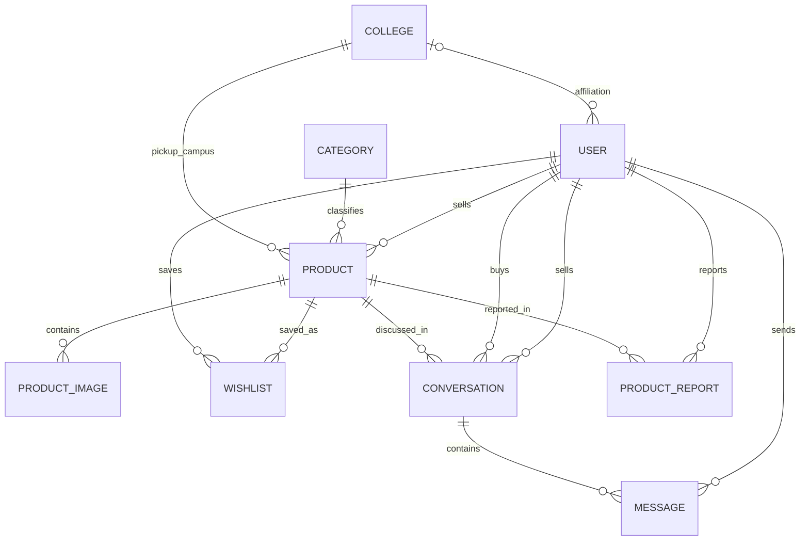

# CampusConnect architecture

CampusConnect is a single Django application. `config/` contains runtime settings and routing. `market/` owns models, forms, views, account verification, rate limits and Django Admin configuration. The templates render HTML on the server, and small scripts handle the theme, image previews, gallery selection, dashboard chart and inbox refreshes.

## Django MVT and the request cycle

1. The request enters Django through WSGI. Middleware applies session, authentication, CSRF and security settings.
2. The URL dispatcher selects a view. The view checks login, ownership or access permissions and validates inputs with a form.
3. The view reads or updates data through the ORM. Public product queries hide drafts, sold and removed items and listings from inactive accounts.
4. The view renders a template or redirects following a successful POST. Client-side enhancements act on the HTML returned by Django.

Market search uses parameterized `icontains` queries over titles and descriptions, validated filters, stable ordering and database pagination. Listing cards preload foreign keys with `select_related` and photos with `prefetch_related`. Composite indexes support public listing status, date, category, college and price. Text search uses substring matching, so large catalogs may need PostgreSQL full-text or trigram indexing.

## Entity relationships

Profile fields live on the custom user entity. Rate limits use a separate `RateBucket` keyed by a hash of the window and caller identifier. The database enforces case-insensitive unique email, nonnegative prices, one wishlist row per user and product, one thread per product and pair, distinct conversation participants and one report per reporter and product. Colleges and categories referenced by listings are protected from deletion. Deleting a listing cascades to its photos, saved entries, conversations and reports. Staff removal keeps the record and its moderation history.

## Authentication and notifications

Registration normalizes email and uses Django's password validators and hashers. Email confirmation uses a signed token tied to the account email, password and verification state. A POST with CSRF protection confirms the account once. Unconfirmed users can sign in and save drafts. Publishing requires email confirmation. Password resets use Django's separate reset tokens. Student enrollment and college email domains are outside the verification scope.

Django messages show confirmations and errors across redirects. Message records hold read timestamps, and inbox rows display unread counts. There is no separate notification center.

## Messaging flow

A buyer starts a conversation from an active listing. The server checks listing visibility, prevents self-contact and reuses the existing thread when one exists. Both participants can open the thread and send messages. The sender identity comes from the session. The newest page polls the server every 6.5 seconds while the tab is visible. Opening the thread marks the corresponding incoming messages as read. Existing participants can continue discussing a sold listing.

## Security and media decisions

Mutating endpoints use CSRF-protected POST forms. Student actions apply object-level ownership and participant checks. Staff moderation requires Django model permissions. Superusers control account permission changes. Private email addresses never appear on public seller pages. Public forms render escaped user content.

Upload validation checks the declared MIME type, extension, real format, size, decoded dimensions and animation. Pillow re-encodes valid images to WebP, strips metadata and uses random storage keys. Listing edits lock the product row on PostgreSQL to enforce the photo count when two requests overlap. Removed photos are deleted from storage after commit. The database and object storage use separate operations. When a database write fails, the application removes files it recorded as uploaded. A process crash or storage interruption can still leave an unreferenced object. Production media uses a private bucket and expiring signed URLs.

Sensitive endpoints have practical fixed-window limits stored in the database, with account-based limits after sign-in and IP-based limits for anonymous authentication. An ingress proxy may group anonymous traffic under a shared address. Run `prune_rate_limits` periodically to clear expired buckets. Production uses explicit hosts, HTTPS redirects, secure cookies, HSTS and standard Django security headers.
