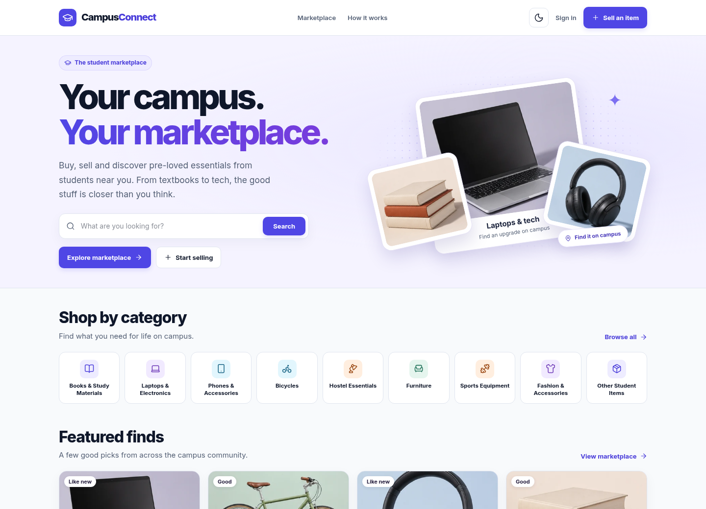
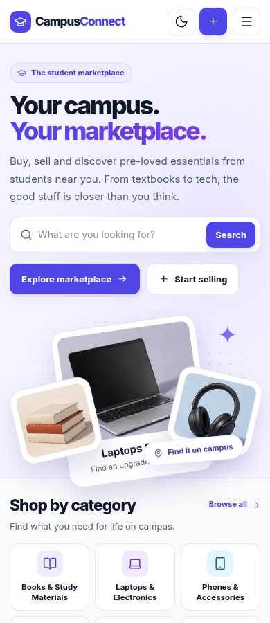

# CampusConnect

**Your Campus. Your Marketplace.**

CampusConnect is a campus-focused marketplace for pre-owned textbooks, electronics, bicycles and student essentials. Buyers can find affordable items nearby, and sellers can arrange exchanges through private listing-specific messages.

## What you can do

- Browse by campus, category, condition and price. Search titles and descriptions, sort results and keep filters while paging.
- Create an account, confirm your email, edit your profile and reset your password.
- Save drafts and publish listings with up to five photos. Edit, reserve, sell or delete your own items.
- Save favorites, message sellers and report suspicious listings.
- View real listing, wishlist and messaging activity on your dashboard.
- Use Django Admin to manage colleges, categories, accounts, listings and reports. Staff permissions control access to moderation.
- Use light or dark mode across mobile, tablet and desktop.

Email confirmation shows that a member can access their inbox. College affiliation is self-reported. CampusConnect does not verify enrollment or process payments.

## Run locally

Use Python 3.12 or newer and run these commands in the project directory.

```bash
python -m venv .venv
source .venv/bin/activate
python -m pip install -r requirements.txt
cp .env.example .env
python manage.py migrate
python manage.py seed_demo
python manage.py runserver
```

Open http://127.0.0.1:8000/. For Windows PowerShell, activate the environment with `.venv\Scripts\Activate.ps1` and use `Copy-Item .env.example .env`.

The demo command creates 27 fictional listings, nine categories from the taxonomy migration, four college entries, four sample accounts, conversations, wishlists and a report. You can rerun the command without duplicating demo records. The demo identities are local-only and use reserved `example.test` addresses.

| Demo account | What to try |
| --- | --- |
| `aarav.demo@example.test` | Open the dashboard, review saved items and list an item |
| `diya.demo@example.test` | Open a second browser session and contact Aarav |
| `isha.demo@example.test` | Reply to a seeded conversation |
| `kabir.demo@example.test` | View a second seeded conversation |

The local demo password is `CampusDemo2026!`. To choose a different password, set `DEMO_PASSWORD` before the first seed. For an empty store, use `python manage.py createsuperuser` and add colleges in `/admin/` before inviting users to register. Categories are populated by a migration.

The default local email backend prints confirmation and password-reset links to the server console. Open the confirmation link and submit the confirmation form.

## Technology and architecture

Django 5.2 serves HTML templates and handles authentication, form validation and ORM queries. The UI uses locally compiled Tailwind CSS, Inter, a Lucide icon sprite, vanilla JavaScript and Chart.js. Messaging uses periodic HTTP requests. SQLite and local images are used in development. Production uses PostgreSQL, an S3-compatible bucket, an SMTP service, Gunicorn and WhiteNoise on Render. See [ARCHITECTURE.md](ARCHITECTURE.md).

Compiled CSS is included so local and Render runs require only Python. To rebuild after editing `assets/app.css`, run Tailwind CLI 4.3.5 from the project root.

```bash
tailwindcss -i assets/app.css -o static/market/app.css --minify
```

Third-party asset licenses are in `static/vendor/`. The product photographs are bundled synthetic illustrations made for the demo and reused across fictional listings.

## Environment variables

| Variables | Usage |
| --- | --- |
| `DJANGO_DEBUG`, `DJANGO_SECRET_KEY` | Development mode and production secret key |
| `DJANGO_ALLOWED_HOSTS`, `CSRF_TRUSTED_ORIGINS`, `PUBLIC_BASE_URL` | Comma-separated hosts, trusted HTTPS origins and canonical public URL |
| `TRUST_HTTPS_PROXY` | Enable only behind a proxy that controls the forwarded HTTPS header |
| `DATABASE_URL`, `DATABASE_SSL_REQUIRE` | PostgreSQL connection URL and SSL policy |
| `EMAIL_BACKEND`, `EMAIL_HOST`, `EMAIL_PORT`, `EMAIL_USE_TLS`, `EMAIL_HOST_USER`, `EMAIL_HOST_PASSWORD`, `DEFAULT_FROM_EMAIL` | Mail backend, SMTP credentials and verified sender |
| `AWS_STORAGE_BUCKET_NAME`, `AWS_S3_REGION_NAME`, `AWS_S3_ENDPOINT_URL` | Media bucket, region and optional S3-compatible endpoint |
| `AWS_ACCESS_KEY_ID`, `AWS_SECRET_ACCESS_KEY` | Restricted bucket credentials |

## Tests

```bash
python manage.py check
python manage.py makemigrations --check --dry-run
python manage.py migrate --check
python manage.py test
```

Set a test PostgreSQL `DATABASE_URL` to run the same suite on PostgreSQL. The configured database user needs permission to create the temporary test database. Run `python manage.py check --deploy --fail-level WARNING` and `python manage.py collectstatic --noinput` with the production environment active to check the deploy configuration.

## Screenshots

| Desktop storefront | Mobile storefront |
| --- | --- |
|  |  |

[Seller dashboard screenshot](docs/screenshots/dashboard.png)

## Deployment and interviews

[DEPLOYMENT.md](DEPLOYMENT.md) covers GitHub, the Render Blueprint, PostgreSQL, persistent media and post-deploy verification. The Blueprint uses paid Render services for the web service and database. [INTERVIEW_GUIDE.md](INTERVIEW_GUIDE.md) includes two project introductions and 30 interview questions.
